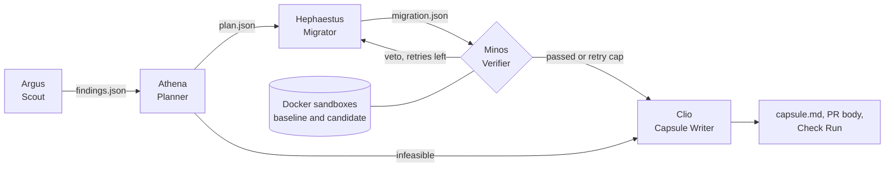

# Themis

Dependency migration harness for npm projects: ranks risky dependencies, migrates one on its own branch, verifies it in a sandbox, and reports every claim with its evidence.


## Install

| You are                       | Do this                                                                                                                                                                            |
| ----------------------------- | ---------------------------------------------------------------------------------------------------------------------------------------------------------------------------------- |
| A repository owner            | Install the GitHub App: [github.com/apps/themis-migrations](https://github.com/apps/themis-migrations). Nothing else to configure. See the [App guide](apps/github-app/README.md). |
| A developer using Claude Code | Run `/plugin install themis --marketplace SatyamPandey-07/H26_UntrainedModels_THEMIS`, then `/themis:scan`. See the [plugin guide](plugin/README.md).                              |
| Running the engine yourself   | Follow [Getting started](#getting-started) below.                                                                                                                                  |

## Overview

Dependency upgrades get postponed because nobody can see which files a library touches, whether tests cover
those files, or whether an AI-written migration preserves behaviour. Themis answers those questions before a
human reviews anything. Scripts and scanners gather facts, a model reasons over them, and a deterministic
Capsule Writer refuses to label a claim as executed unless its log file exists. Themis never writes to the
base branch and never merges.

The full product requirements and architecture are in [docs/Themis-PRD.pdf](docs/Themis-PRD.pdf); build
progress is tracked in [Plan.md](Plan.md).

## Features

- **Risk ranking.** Scores every direct dependency from npm audit, OSV-Scanner and Trivy findings, npm registry
  signals (deprecation, release age, maintainers, major versions behind) and transitive weight from the lockfile.
- **Usage mapping.** Builds an exact file, line and symbol map from Opengrep rules: a fixed import rule plus
  model-written call rules, with a regex fallback when Opengrep is not installed.
- **Branch-only migration.** Applies the plan on `themis/<dependency>-<YYYYMMDD>` in a separate git worktree, one
  commit per concern: lint config, dependency swap, Opengrep autofixes, model edits, characterization tests.
- **Characterization tests.** Generates tests for affected call sites and keeps only those that pass on the
  base commit with the old dependency; the rest are listed as gaps.
- **Baseline versus candidate verification.** Builds both commits in identical Docker sandboxes (no network
  after install, resource limits, read-only root filesystem) and judges only the difference: new test failures,
  lint delta, new vulnerability IDs, leftover imports and black-box probe mismatches. The Verifier's veto is final.
- **Dependency Exit Capsule.** Writes `capsule.json`, `capsule.md`, a draft PR body and Check Run annotations.
  Every claim carries one of four provenance tags and passes an evidence gate.

## How it works



Hermes, the orchestrator, runs the stages in order, persists run state after each one, retries a vetoed
migration up to `THEMIS_RETRY_CAP` times, and always finishes with a capsule, including when a stage fails.
Clio is plain code, not a model, so provenance tags cannot be argued into place.

| Tag              | Established by                                 | Evidence the gate requires                           |
| ---------------- | ---------------------------------------------- | ---------------------------------------------------- |
| `OBSERVED`       | A script read the repository or a registry API | File and line, or source URL                         |
| `EXECUTED`       | A command ran                                  | Exact command, exit code, and a log file that exists |
| `AI-RECOMMENDED` | The model reasoned over observed data          | Model name and the inputs it saw                     |
| `UNVERIFIED`     | Nothing backs it                               | A reason; listed openly as a gap                     |

A claim that fails the gate is downgraded to `UNVERIFIED` and listed in the capsule.

## Project status

| Component                                                                         | Status                                      |
| --------------------------------------------------------------------------------- | ------------------------------------------- |
| Core engine (`packages/core`): Scout, Planner, Migrator, Verifier, Capsule Writer | Implemented                                 |
| Orchestrator and `themis` CLI, including plugin step commands                     | Implemented                                 |
| Runner workflow on GitHub Actions (`.github/workflows/themis-runner.yml`)         | Implemented; live runs on a WorkSphere fork |
| GitHub App webhook server (`apps/github-app`)                                     | Implemented; Vercel deployment pending      |
| Claude Code plugin and marketplace (`plugin/`, `.claude-plugin/`)                 | Implemented                                 |
| GitHub Marketplace listing                                                        | Not submitted yet                           |

## Tech stack

| Layer             | Technology                                                                    | Purpose                                                    |
| ----------------- | ----------------------------------------------------------------------------- | ---------------------------------------------------------- |
| Runtime           | Node.js 22 or later, TypeScript 6.0                                           | Engine and CLI                                             |
| Package manager   | pnpm 10.30 (workspace)                                                        | Monorepo installs and scripts                              |
| Model             | Groq `openai/gpt-oss-120b` via `groq-sdk` 1.6                                 | Rule authoring, migration plan, edits, tests, probe choice |
| Contracts         | zod 4.6                                                                       | Schemas for every stage file and the capsule               |
| Process execution | execa 10.1                                                                    | Evidence-logged command runner                             |
| Analysis          | Opengrep 1.30.2, OSV-Scanner 2.7.0, Trivy 0.76.0, npm audit                   | Usage maps, autofixes, vulnerability data                  |
| Sandbox           | Docker, `docker/sandbox.Dockerfile` (Node 22 image)                           | Isolated baseline and candidate builds                     |
| Skills            | 15 folders in the [Agent Skills](https://agentskills.io/specification) format | Instructions each agent loads                              |

## Repository structure

```text
.
├── packages/core/              Themis engine and the `themis` CLI
│   └── src/
│       ├── agents/             Scout, Planner, Migrator, Verifier, agent loop, scoped file tools
│       ├── capsule/            Evidence gate and capsule, PR body and Check Run writer
│       ├── sandbox/            Docker sandbox, host fallback, test runner adapters
│       ├── tools/              Scanners, registry, lockfile graph, Opengrep, git, lint
│       ├── schema/             zod contracts for findings, plan, migration, verification, capsule
│       ├── orchestrator.ts     Stage sequencing, retries, alerts
│       ├── steps.ts            Step commands for the Claude Code plugin
│       └── cli.ts              Command-line entry point
├── apps/github-app/            Probot webhook server, dashboard, publish and rescan steps (see its README)
├── plugin/                     Claude Code plugin with the bundled CLI (see its README)
├── .claude-plugin/             Plugin marketplace manifest
├── .github/workflows/          Runner workflow that executes every App run
├── skills/                     15 agent skills (SKILL.md plus scripts, references, assets)
├── docker/                     Sandbox image definition
├── scripts/                    Scanner installer and plugin build
├── docs/                       Product requirements and architecture
├── PRIVACY.md                  Privacy policy for the App and plugin
└── Plan.md                     Build plan with progress checkboxes
```

## Getting started

### Prerequisites

- [Node.js](https://nodejs.org/) 22 or later
- [pnpm](https://pnpm.io/installation) 10.30 (enable with Corepack, below)
- [Git](https://git-scm.com/)
- A [Groq API key](https://console.groq.com/keys) for `plan` and `run` (the free tier works with the default token budget)
- Optional, for isolated verification: [Docker](https://docs.docker.com/get-docker/) with a running daemon
- Optional, for full analysis on Linux x86_64: Opengrep, OSV-Scanner and Trivy via `scripts/install-tools.sh`

Missing scanners are reported as `UNVERIFIED` gaps in the capsule rather than failing the run. Without Docker,
verification runs on the host and the capsule records that isolation was not verified; in CI, Docker is required.

### Installation

1. Clone the repository and install dependencies:

   ```bash
   git clone https://github.com/SatyamPandey-07/H26_UntrainedModels_THEMIS.git
   cd H26_UntrainedModels_THEMIS
   corepack enable
   pnpm install
   ```

2. Create your environment file and add your Groq key:

   ```bash
   cp .env.example .env
   ```

3. Build the engine:

   ```bash
   pnpm build
   ```

4. Optional: install the analysis tools into `~/.local/bin`:

   ```bash
   scripts/install-tools.sh
   ```

The CLI is now available at `packages/core/dist/cli.js`.

### Environment variables

| Variable                       | Required             | Description                                                                            | Example                            |
| ------------------------------ | -------------------- | -------------------------------------------------------------------------------------- | ---------------------------------- |
| `GROQ_API_KEY`                 | For `plan` and `run` | Groq API key used by the agents. `scan` and the plugin's step commands work without it | `your-groq-api-key`                |
| `GROQ_MODEL`                   | No                   | Groq model with tool calling                                                           | `openai/gpt-oss-120b` (default)    |
| `THEMIS_RETRY_CAP`             | No                   | Migration retries after a Verifier veto                                                | `2` (default)                      |
| `THEMIS_MAX_OPEN_PRS`          | No                   | Open Themis PRs allowed per repository                                                 | `3` (default)                      |
| `ALERT_WEBHOOK_URL`            | No                   | Receives a JSON alert when a run completes or fails                                    | `https://example.com/hooks/themis` |
| `ALERT_WEBHOOK_SECRET`         | No                   | Signs alerts in the `x-themis-signature-256` header (HMAC-SHA256)                      | `your-shared-secret`               |
| `THEMIS_FULL_TESTS`            | No                   | Set to `1` to run the full test suite instead of related and characterization tests    | `1`                                |
| `THEMIS_SKILLS_DIR`            | No                   | Overrides the location of the `skills/` folder                                         | `/opt/themis/skills`               |
| `THEMIS_PROMPT_TOKEN_BUDGET`   | No                   | Estimated prompt tokens per model request; older tool output is trimmed to fit         | `5000` (default)                   |
| `THEMIS_MAX_COMPLETION_TOKENS` | No                   | Tokens reserved for each model response                                                | `2500` (default)                   |
| `THEMIS_REASONING_EFFORT`      | No                   | Reasoning effort for `gpt-oss` models: `low`, `medium` or `high`                       | `low` (default)                    |

Themis reads `.env` from the target repository or its parent directories. When you run it against a repository
outside this checkout, export the variables first:

```bash
set -a; . ./.env; set +a
```

The `APP_ID`, `PRIVATE_KEY_PATH`, `WEBHOOK_SECRET` and `WEBHOOK_PROXY_URL` entries in `.env.example` belong to
the GitHub App and are not read by the engine.

## Usage

Run every command against a git repository that has a `package.json`. `-C` selects the repository; `--json`
prints machine-readable output.

```bash
node packages/core/dist/cli.js -C /path/to/repo scan
```

Ranks direct dependencies by risk score and prints the recommended one: the highest-ranked runtime dependency
with a known vulnerability or deprecation. Read-only.

```bash
node packages/core/dist/cli.js -C /path/to/repo plan moment
```

Maps every use of the package and writes a migration plan: upgrade or replace, target version, behavioural
differences and ordered concerns. Read-only. Omit the package name to plan the recommended dependency.

```bash
node packages/core/dist/cli.js -C /path/to/repo run moment
```

Runs the full pipeline and prints the verdict (`Migrated and verified`, `Migrated, gaps remain` or
`Not recommended`), the branch name and the capsule path. The branch stays local; Themis does not push.

| Command            | Purpose                                                                                              |
| ------------------ | ---------------------------------------------------------------------------------------------------- |
| `scan`             | Rank dependencies (read-only)                                                                        |
| `plan [package]`   | Usage map and migration plan (read-only)                                                             |
| `run [package]`    | Full pipeline; `--full-tests` runs the whole test suite, `--resume <runDir>` reuses completed stages |
| `recommend`        | Print the dependency Themis would migrate next                                                       |
| `capsule <runDir>` | Rebuild the capsule, PR body and Check Run from a run's stage files                                  |

Each run writes to `.themis/runs/<runId>/` inside the target repository:

```text
state.json          stage status and events
tools.json          tool versions
evidence.jsonl      one line per command: text, exit code, duration, log path
logs/               full output of every command
agents/             model transcripts
findings.json       Scout output
plan.json, rules/   Planner output and Opengrep rules
migration.json      Migrator output
verification.json   Verifier output
capsule.json        machine-readable capsule
capsule.md          human-readable capsule
pr-body.md          draft pull request body
check-run.json      Check Run conclusion, summary and annotations
```

## Agent skills

Each agent loads its own skills plus three shared ones. The skills follow the Agent Skills specification, so
other agent harnesses can load the same folders.

| Agent      | Role           | Skills                                                            |
| ---------- | -------------- | ----------------------------------------------------------------- |
| Hermes     | Orchestrator   | `stage-routing`, `retry-policy`                                   |
| Argus      | Scout          | `toolchain-detect`, `dependency-risk-rank`                        |
| Athena     | Planner        | `opengrep-rule-author`, `usage-map`                               |
| Hephaestus | Migrator       | `migrate-dependency`, `characterization-tests`                    |
| Minos      | Verifier       | `sandbox-verify`, `blackbox-probe-diff`                           |
| Clio       | Capsule Writer | `capsule-write`, `pr-report`                                      |
| All        | Shared         | `provenance-tagging`, `untrusted-input-guard`, `evidence-logging` |

Repository text, comments and tool output reach the model wrapped as untrusted data, agent file tools are
confined to the repository, and child processes receive an environment without Groq, GitHub App or webhook
secrets.

## Development

```bash
pnpm lint             # ESLint across the workspace
pnpm typecheck        # tsc --noEmit for every package
pnpm build            # compile packages/core to dist/
pnpm skills:validate  # check all skills against the Agent Skills specification
pnpm format           # Prettier
```

## Team

| Member           | GitHub                                                 |
| ---------------- | ------------------------------------------------------ |
| Yash Singh       | [@YashSingh-18](https://github.com/YashSingh-18)       |
| Ayush Shukla     | [@ayushsshukla](https://github.com/ayushsshukla)       |
| Satyam Pandey    | [@SatyamPandey-07](https://github.com/SatyamPandey-07) |
| Keerthan Poojary | [@Thundercloud12](https://github.com/Thundercloud12)   |
