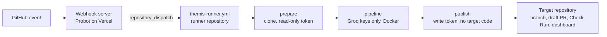

# Themis GitHub App

Install-only dependency migrations for npm repositories: the App ranks risky dependencies, opens a Dependency
Dashboard issue, and opens draft pull requests with an evidence capsule. Part of [Themis](../../README.md).

## For repository owners

### Install

Open [github.com/apps/themis-migrations](https://github.com/apps/themis-migrations), select **Install**, and choose
the repositories. There is nothing else to configure: no workflow file, no secrets, no API key.

Requirements: a public repository with a `package.json` and Issues enabled. Private repositories are refused while
the runner repository is public; see [PRIVACY.md](../../PRIVACY.md).

### What happens after install

1. Themis scans each selected repository and opens a **Themis Dependency Dashboard** issue listing direct
   dependencies by risk score, with a checkbox per dependency.
2. If the top-ranked runtime dependency has a known vulnerability or is deprecated, Themis migrates it
   automatically, at most once every 7 days.
3. A migration ends in a **draft pull request** from `themis-migrations[bot]` on a `themis/<dependency>-<date>`
   branch, a **Themis** Check Run with line annotations, and the capsule committed under `.themis/`.
4. The dashboard is rescanned every Monday.

### Requesting a migration

| Action                                                         | Who                           | Effect                                        |
| -------------------------------------------------------------- | ----------------------------- | --------------------------------------------- |
| Tick a box on the Dependency Dashboard                         | Anyone with write access      | Migrates that dependency                      |
| Comment `/themis <package>` on any issue                       | Owner, member or collaborator | Migrates the package and replies on the issue |
| Comment `/themis`                                              | Owner, member or collaborator | Migrates the recommended dependency           |
| Add the `themis` label to an issue whose title names a package | Anyone with write access      | Migrates that package                         |

Limits: one open Themis pull request per dependency and three per repository by default. Themis never merges and
never writes to the default branch.

### Optional configuration

Add `.github/themis.yml` to change the defaults:

```yaml
autoMigrate: true # migrate the top risky dependency automatically
autoMigrateIntervalDays: 7 # minimum days between automatic migrations
ignore: # dependencies Themis must never propose
  - react
maxOpenPrs: 3 # open Themis pull requests allowed at once
```

An invalid file is ignored and Themis comments the reason on the dashboard.

## For maintainers

### How it works



The webhook server only validates events, checks limits and dispatches; it must answer within GitHub's 10-second
delivery timeout. All analysis runs in [`.github/workflows/themis-runner.yml`](../../.github/workflows/themis-runner.yml).

| Source                   | Purpose                                                                                                 |
| ------------------------ | ------------------------------------------------------------------------------------------------------- |
| `src/app.ts`             | Probot handlers: install scans, `/themis` comments, dashboard ticks, `themis` label, Marketplace events |
| `src/dashboard.ts`       | Dependency Dashboard rendering and tick detection                                                       |
| `src/config.ts`          | `.github/themis.yml` schema                                                                             |
| `src/publish.ts`         | Publish job: pushes the branch, opens the draft PR, Check Run, dashboard, alerts                        |
| `src/rescan.ts`          | Weekly rescan of every repository with a dashboard                                                      |
| `api/github/webhooks.ts` | Vercel function entry point                                                                             |

### Runner repository setup

In the runner repository, under **Settings → Secrets and variables → Actions**:

| Name                                        | Kind              | Value                                                                    |
| ------------------------------------------- | ----------------- | ------------------------------------------------------------------------ |
| `THEMIS_APP_CLIENT_ID`                      | Variable          | The App's Client ID                                                      |
| `THEMIS_APP_PRIVATE_KEY`                    | Secret            | The App's private key (PEM, pasted as is)                                |
| `GROQ_API_KEY_1` … `GROQ_API_KEY_5`         | Secret            | Groq API keys, tried in order (one is enough; `GROQ_API_KEY` also works) |
| `GROQ_FALLBACK_MODEL`                       | Variable          | Model tried after `GROQ_MODEL` on each key (default `qwen/qwen3.8-27b`)  |
| `ALERT_WEBHOOK_URL`, `ALERT_WEBHOOK_SECRET` | Secrets, optional | Alert receiver and signing secret                                        |

Install the App on the runner repository too, so the webhook server can dispatch runs there.

### Deploy the webhook server (Vercel)

1. Import the repository in Vercel and set **Root Directory** to `apps/github-app`.
2. Add environment variables:

   | Variable         | Value                                 |
   | ---------------- | ------------------------------------- |
   | `APP_ID`         | The App's numeric ID                  |
   | `PRIVATE_KEY`    | The App's private key, PEM contents   |
   | `WEBHOOK_SECRET` | The App's webhook secret              |
   | `RUNNER_REPO`    | `owner/name` of the runner repository |

3. Deploy, then set the App's **Webhook URL** to `https://<project>.vercel.app/api/github/webhooks`.

### Run by hand

```bash
gh workflow run themis-runner.yml -R SatyamPandey-07/H26_UntrainedModels_THEMIS \
  -f repository=owner/name -f mode=run -f package=moment -f issue_number=1
```

`mode=scan` updates the dashboard only; leave `package` empty to migrate the recommended dependency.

### Build

```bash
pnpm --filter @themis/github-app... build
```
